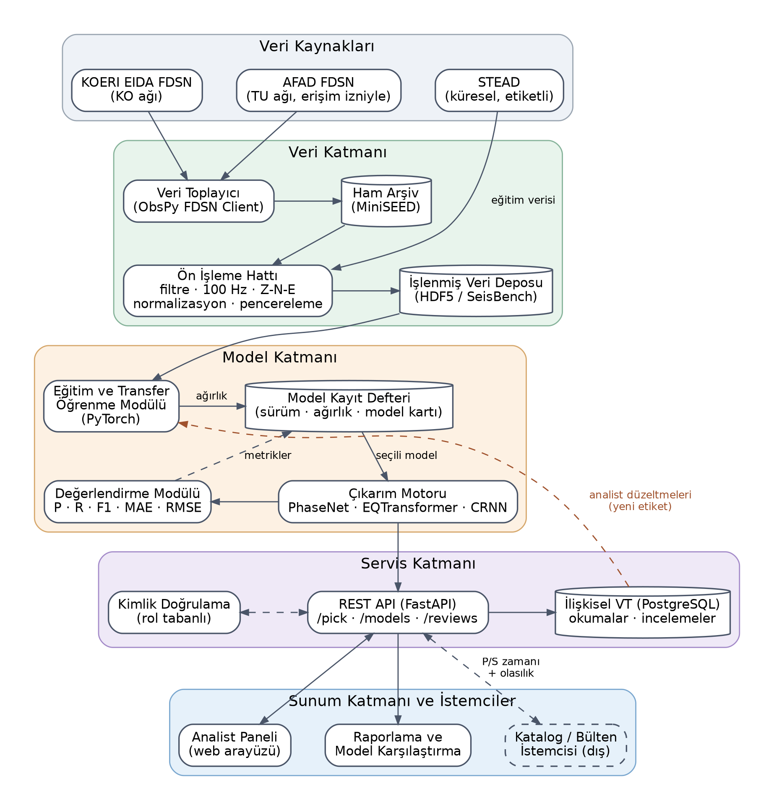
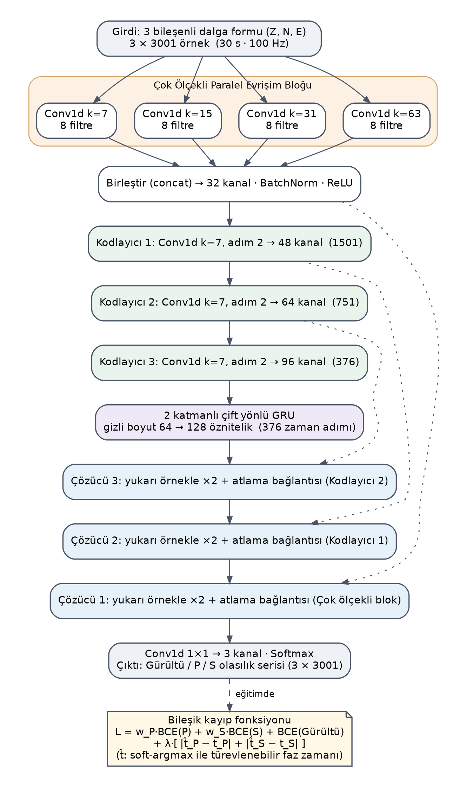
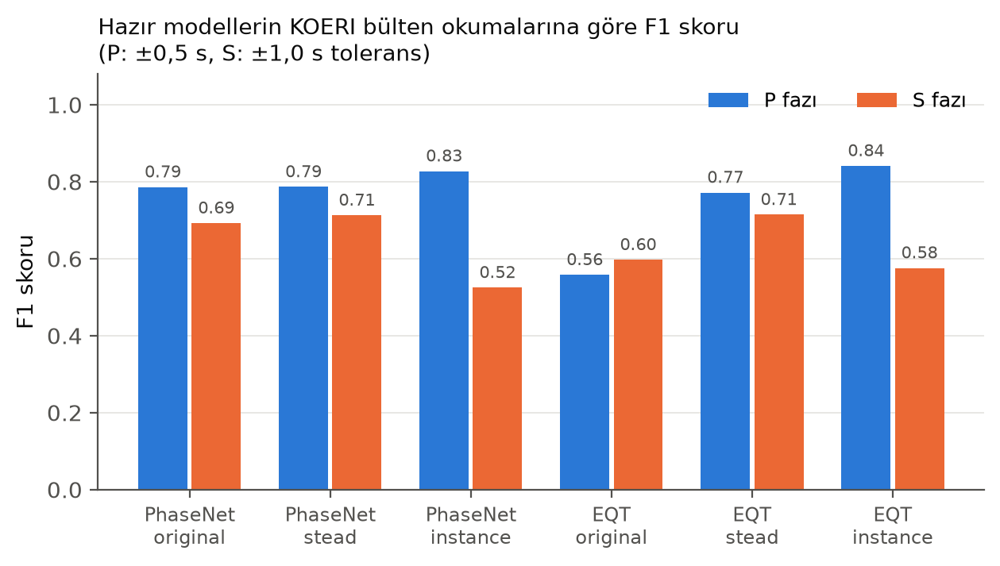
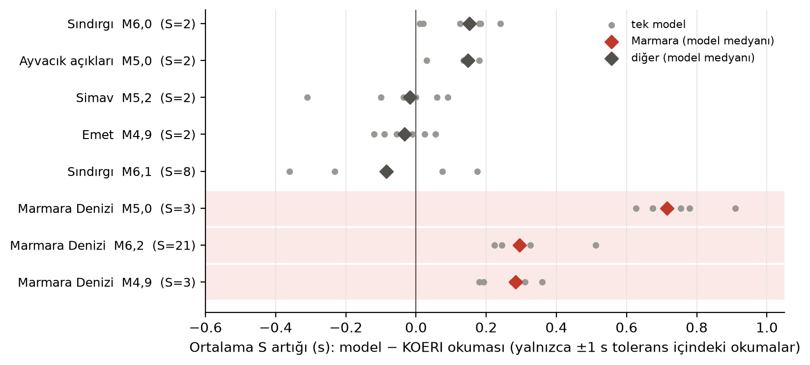
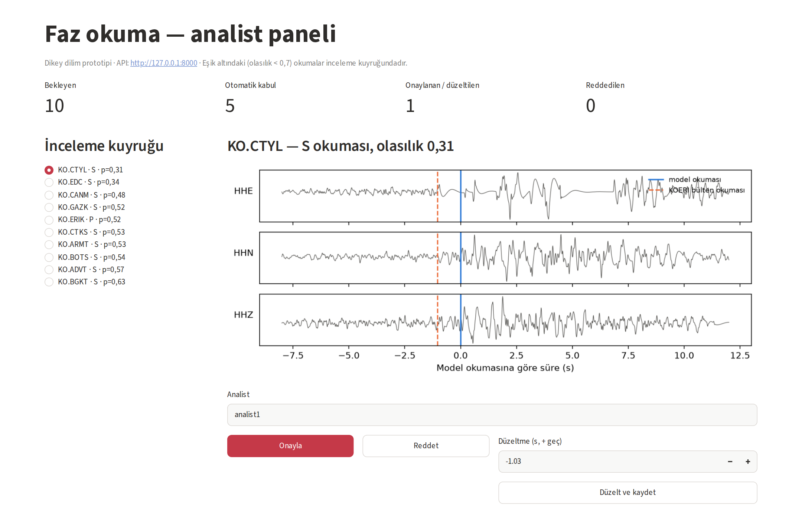

# Türkiye'ye Özgü Sismik Veriler için Otomatik Faz Okuma ve Karar Destek Sistemi

Türkiye kayıtlarında P ve S dalgalarının varış zamanlarını derin öğrenmeyle otomatik okuyan ve okumaların analist tarafından onaylanıp düzeltildiği bir **karar destek sistemi** için tasarım ve prototip.

> İstanbul Ticaret Üniversitesi, Bilgisayar Mühendisliği. *Bilişim Tasarım Projesi* (2026–2027). **Durum:** tasarım tamamlandı; veri hattı, CRNN prototipi, ön deneme ve uçtan uca dikey dilim (API + SQLite + analist paneli) çalışıyor; model eğitimi 2027 baharında.

## Neden?

Deprem kataloğunun ve sismik izlemenin ilk adımı faz okumadır. Hazır derin öğrenme modelleri (PhaseNet, EQTransformer) bölgeler arasında genellikle hafif başarım kaybıyla aktarılabiliyor (Münchmeyer vd., 2022). Ancak SeisBench'teki 29 hazır ağırlığın hiçbiri Türkiye'ye özgü bir veriyle eğitilmemiştir (küresel kümelerde Türkiye kaynaklı iz payı: STEAD %0,43, GEOFON %1,13; `src/kuresel_kume_turkiye.py`) ve Türkiye'deki faz bazlı davranışları yeterince belgelenmemiştir. Makine öğrenmesi okumalarını analist denetimine açan operasyonel araçlar (GFZ scdlpicker, gempa dlpick) mevcuttur; bu projenin farkı, **analist düzeltmelerini sürümlü bir yeniden eğitim döngüsüne bağlamak** ve Türkiye'de faz bazlı değerlendirmedir.

## Sistem mimarisi



| Katman | Bileşenler |
|---|---|
| Veri | KOERI EIDA FDSN istemcisi (ObsPy), ön işleme (filtre, 100 Hz, Z-N-E), HDF5 deposu |
| Model | PhaseNet, EQTransformer (SeisBench) ve özgün **CRNN** (`src/crnn_model.py`), eğitim/transfer öğrenme, değerlendirme |
| Servis *(dikey dilim çalışıyor)* | FastAPI REST API (`servis/api.py`), SQLite → PostgreSQL, rol tabanlı yetkilendirme *(planlandı)* |
| Sunum *(dikey dilim çalışıyor)* | Analist paneli (`servis/panel.py`): okumayı onayla / düzelt / reddet → düzeltme yeni eğitim etiketi olur |

Diğer tasarım belgeleri `diyagramlar/` altında: kullanım senaryosu, sınıf diyagramı, aktivite diyagramı, veri akış diyagramları (seviye 0 ve 1), ER diyagramı ve arayüz taslağı. Kaynaklar `.puml` (PlantUML) ve `.dot` (Graphviz) biçiminde, çıktılar `png/` altında.

## Özgün CRNN



- Çok ölçekli paralel evrişim (k = 7, 15, 31, 63), 3 kodlayıcı blok, 2 katmanlı çift yönlü GRU, atlama bağlantılı çözücü. Toplam **357.571 parametre**.
- **Bileşik kayıp:** `L = BCE_N + w_P·BCE_P + w_S·BCE_S + λ(|t̂_P − t_P| + |t̂_S − t_S|)`. Burada `t̂`, olasılık eğrisinin **yerel** soft-argmax'ı (en yüksek tepenin ±1 s çevresi); küresel soft-argmax taban olasılıkla pencere ortasına kayar ve iki olaylı pencerede tepelerin arasına düşer. Pencerede faz yoksa zaman terimi maskelenir.
- **Durum:** kodlandı ve test edildi, **henüz eğitilmedi.**

## Ön deneme: hazır modeller KOERI okumalarına karşı

- **Veri:** 2025'teki 8 Batı Türkiye depremi (M4,9–6,2), 47 KO istasyonu (18–165 km).
- **Referans:** 153 P + 43 S okuması. Kaynak, ISC bülteninin ISF çıktısında raporlayan ajansı **ISK** (KOERI) olan satırlar.
- **Tolerans:** P için ±0,5 s, S için ±1,0 s.
- **Eşik:** Tüm ağırlıklara ortak 0,3 uygulandı.

| Model | P F1 | S F1 | S ortalama sapma (s) |
|---|---|---|---|
| PhaseNet (original) | 0,79 | 0,69 | +0,23 |
| PhaseNet (STEAD) | 0,79 | 0,71 | +0,15 |
| PhaseNet (INSTANCE) | 0,83 | 0,52 | +0,19 |
| EQTransformer (original) | 0,56 | 0,60 | +0,20 |
| EQTransformer (STEAD) | 0,77 | 0,71 | +0,16 |
| EQTransformer (INSTANCE) | **0,84** | 0,58 | +0,20 |



**S gecikmesi olay bazında:** Ortalama S sapması (+0,15…+0,23 s) yanıltıcıdır. Gecikme esasen 23 Nisan 2025 Marmara dizisinde (M6,2 ve aynı gün M4,9; 24 S okuması, ≈ +0,3 s). 2 Ekim M5,0 olayındaki +0,72 s yalnızca 3 okumaya dayanır; diğer beş depremde (16 S, 8'i tek olaydan) sapma −0,09…+0,15 s'dir. Olay düzeyinde %95 güven aralığı 6 modelin 3'ünde sıfırı içerir. Bu nedenle bulgu, asıl deneyde sınanacak bir hipotezdir (`src/olay_analizi.py`).



**Veri hacmi:** ISC bülteninden rastgele 12 haftalık örneklemle 2020–2025 için 200 km içinde yaklaşık 1,37 milyon P ve 0,46 milyon ISK S okuması bekleniyor; bunların ~%19'u Doğu Anadolu Fay Zonu çevresinde. KOERI servisinden tümünü tek akışla indirmek ≈ 2 ay sürer (`src/indirme_hizi.py`).

Tüm sonuçlar `sonuclar/` altında: `ozet_metrikler.csv`, `eslesmeler.csv`, `referans_okumalar.csv`, `olay_bazli_artik.csv`, `artik_ayristirma.csv`, `veri_hacmi_tahmini.csv`, `guc_analizi.csv`, `ON_DENEME_OZETI.md`.

**F1 belirsizliği:** Olay düzeyinde bootstrap ile P F1 güven aralıkları ≈ ±0,07; S'de çok geniş (ör. STEAD 0,61–0,95), bu yüzden S F1 farkları anlamlı değildir. M6,2 depremi çıkarıldığında S F1 0,71'den 0,86'ya çıkıyor; S başarımını büyük ölçüde bu olay aşağı çekiyor (`sonuclar/f1_guven_araligi.csv`). INSTANCE ağırlıkları P'de güçlü ama S'de zayıf; STEAD iki fazda dengeli.

**Sınırlılıklar:**
- Örneklem küçük (8 olay). Olay düzeyinde bootstrap güven aralıkları hesaplandı (8 olayla yaklaşık); McNemar gibi eşleştirilmiş testler ve pratik eşiğe dayalı karar asıl deneyde yapılacak.
- Bültende okumanın elle mi otomatik mi yapıldığı belirtilmiyor.
- S referansı az (43 okuma) ve yarısı tek depremden.
- FP yalnızca referanslı istasyon/fazda sayıldı; precision iyimserdir.
- Hazır ağırlıkların kendi varsayılan eşikleri denenmedi.

## Depo yapısı

```
src/
  crnn_model.py     özgün CRNN + bileşik kayıp
  on_deneme.py      veri indirme (USGS, ISC ISF, KOERI FDSN) + hazır modellerle değerlendirme
  hiz_olcumu.py     CPU çıkarım süresi ölçümü
  grafikler.py      sonuç grafikleri
  olay_analizi.py   S gecikmesinin olay / bölge / Sg-Sn ayrıştırması, olay bootstrap'ı
  veri_hacmi_tahmini.py  2020–2025 KOERI okuma sayısı tahmini (DAFZ çevresi ayrı) + güç analizi
  indirme_hizi.py   KOERI FDSN indirme hızı ölçümü (tüm kayıtlar tek akışla ≈ 2 ay)
  kuresel_kume_turkiye.py  STEAD/GEOFON/NEIC üst verisinde Türkiye kayıtlarının payı
servis/             dikey dilim: api.py (FastAPI+SQLite), panel.py (Streamlit), okuyucu.py (FazOkuyucu), demo_video.py
tests/              birim ve entegrasyon testleri (pytest, 23 test)
diyagramlar/        UML / DFD / ER / mimari (kaynak + PNG)
sonuclar/           ön deneme sonuçları (CSV) ve özet
sekiller/           grafikler
veri/               ham veri (git'e eklenmez; bkz. veri/README.md)
```

## Kurulum ve çalıştırma

```bash
python3 -m venv .venv
.venv/bin/pip install torch==2.15.0 --index-url https://download.pytorch.org/whl/cpu
.venv/bin/pip install -r requirements.txt

.venv/bin/python -m pytest -q tests        # birim testleri
.venv/bin/python src/crnn_model.py         # CRNN doğrulaması
.venv/bin/python src/on_deneme.py          # veriyi indirir ve ön denemeyi çalıştırır (~10–40 dk)
.venv/bin/python src/grafikler.py          # grafikler
.venv/bin/python src/hiz_olcumu.py         # hız ölçümü
.venv/bin/python src/olay_analizi.py       # olay bazlı S analizi
```

### Dikey dilim

```bash
.venv/bin/uvicorn servis.api:app --port 8000          # API (ilk istekte PhaseNet-STEAD indirilir)
.venv/bin/python -m servis.ornek_yukle us7000pufs 10  # src/on_deneme.py ile indirilmiş kayıtları yükler
.venv/bin/streamlit run servis/panel.py               # http://localhost:8501
```



Altyazılı demo videosu (40 s; API'ye kayıt yükleme → panelde onay/düzeltme → eğitim etiketleri): [`sekiller/dikey_dilim_demo.mp4`](sekiller/dikey_dilim_demo.mp4)

Diyagramları yeniden üretmek için Graphviz ve PlantUML gerekir:

```bash
cd diyagramlar && for f in *.dot; do dot -Tpng -Gdpi=200 $f -o png/${f%.dot}.png; done && plantuml -tpng -charset UTF-8 -o png *.puml
```

## Veri kaynakları ve atıf

- **Dalga formları:** Kandilli Observatory and Earthquake Research Institute, Boğaziçi University (1971). *KOERI* [Data set]. https://doi.org/10.7914/SN/KO
- **Faz okumaları:** International Seismological Centre (2026). *ISC Bulletin*. https://doi.org/10.31905/D808B830. 2024/11 sonrası veriler ISC tarafından henüz gözden geçirilmemiştir.
- **Olay listesi:** USGS ComCat.
- **Hazır modeller:** SeisBench (Woollam vd., 2022). PhaseNet (Zhu & Beroza, 2019), EQTransformer (Mousavi vd., 2020).

## Yol haritası

| Dönem | İş |
|---|---|
| Kas 2026 – Oca 2027 | Veri hattını tam ölçeğe çıkarma (2020–2025), tam baseline |
| Şub – Mar 2027 | CRNN eğitimi ve 5 model transfer öğrenme deneyi |
| Mar – Nis 2027 | Dikey dilimi genişletme: kimlik doğrulama, PostgreSQL, kör inceleme modu |
| Nis – May 2027 | Karşılaştırmalı değerlendirme, istatistiksel testler, SUS kullanıcı testi |

## Katkı ve teşekkür

Projenin temelindeki araştırma önerisi (TÜBİTAK 2209-A / İstanbul Ticaret Üniversitesi BAP), Burak Can Tarhan, Hayrunnisa Açıkgöz ve Öğr. Gör. Dr. Dilara İçkecan tarafından birlikte hazırlanmıştır. CRNN'in çok ölçekli evrişim, P/S ayrı cezalı kayıp ve veri artırma fikirleri ile beş modellik deney tasarımı bu öneride tanımlanmıştır.

## Yapay zekâ kullanımı

Kod, diyagram kaynakları ve belgelerin hazırlanmasında Anthropic Claude (Claude Code) destekleyici araç olarak kullanılmıştır. Tüm sonuçlar bu depodaki kodun ürettiği dosyalardan gelmektedir.

## Lisans

MIT. Ayrıntı için `LICENSE` dosyasına bakın.
